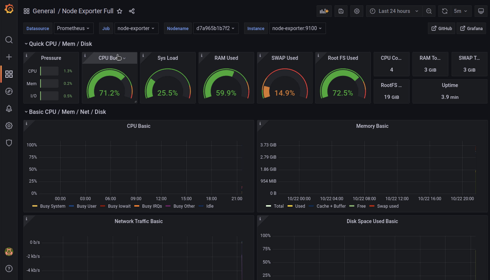
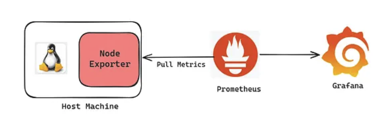

# Системы мониторинга Prometeus, Grafana и другие.

# Задание:

Провести настройку Prometeus, Grafana. Администрирование, мониторинг работы сервера
Практическое применение для анализа производительности, ресусов.
Настройка автоматических уведомлений (почта, системы мгновенных сообщений и т.п.)

## Ну что буду оформлять данную работу в виде статьи с моим опытом и ошибками

Первое что сделал я - стал разбираться как устроена Grafana и Prometheus,
зачем оши нужны и с чем их едят?

Наткнулся на видео ролик по становке и настройке графаны для мониторинга системы Ubuntu.
[Ссылка на видеоролик](https://www.youtube.com/watch?v=X_g-eJqiiLo)
Там я разобрался как в Docker поднять систему и настроить кластер для того чтобы следить
за системой

Результаты:



Что у меня получилось?

1) Запусить контейнер в docker с grafana + prometheus + node exporter
2) Посмотреть логи и нагрузку системы Ubuntu

- Grafana - платформа для визуализации, мониторинга и анализа данных
- Prometheus - система мониторинга и сбора метрик
- Node exporter - служебная программа, которая собирает аппаратные и систменые метрики операционной системы

Вот такая схема у меня получилась 




## Идем дальше, а чем дальше тем интереснее 

Я взялся за задачу построить такое взаимодейстие:

У меня есть несколько рабочих проектов расположенных на сервере и я хочу получать статистику нагрузки на каждый их проектов.

Пойдем по шагам и будем делать сначала на локальной машине:

1) Шаг №1 Поднять grafana + prometheus
2) Шаг №2 Сделать exporter логов из проектов
3) Шаг №3 Собрать полноценую систему

№1 

docker-compose.yml 

```yaml
version: '3.8'

services:
  prometheus:
    image: prom/prometheus:latest
    container_name: prometheus
    volumes:
      - ./prometheus.yml:/etc/prometheus/prometheus.yml
    ports:
      - "9090:9090"
    extra_hosts:
      - "host.docker.internal:host-gateway"

  grafana:
    image: grafana/grafana:latest
    container_name: grafana
    ports:
      - "3000:3000"
    environment:
      - GF_SECURITY_ADMIN_PASSWORD=admin
    volumes:
      - grafana-data:/var/lib/grafana

volumes:
  grafana-data:
```

prometheus.yml

```yaml
global:
  scrape_interval: 15s

scrape_configs:
  - job_name: 'test_bot'
    static_configs:
      - targets: ['host.docker.internal:8000']
```


У нас появиться 2 котейнера и так же настройки prometheus

Немного теории.


1. Pull-модель. Приложение не отправляет метрики, а выставляет их текстом по HTTP на /metrics. Prometheus по расписанию (scrape) забирает их.
2. Временной ряд = имя метрики + набор меток + значения во времени. Пример: http_requests_total{method="POST", status="500"}.

   Существуют четыре типа метрик:

- Counter - счетчик событий
- Gange - кол-во запросов
- Histogram - время ответ
- Summary

3) Кардинальность — количество уникальных комбинаций меток.

# Для того чтобы общаться с ptometheus используется PromQL - язык запросов
