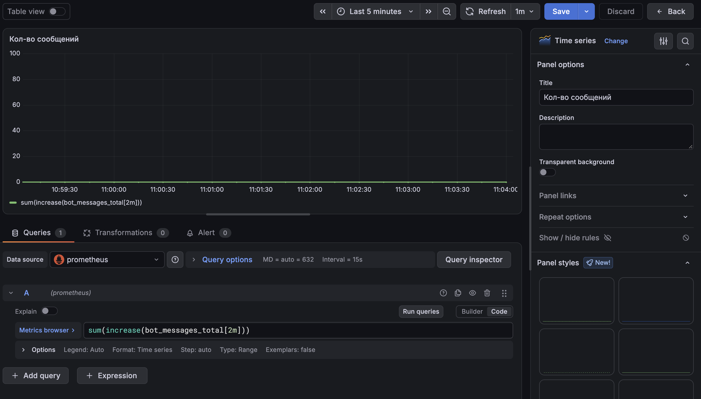
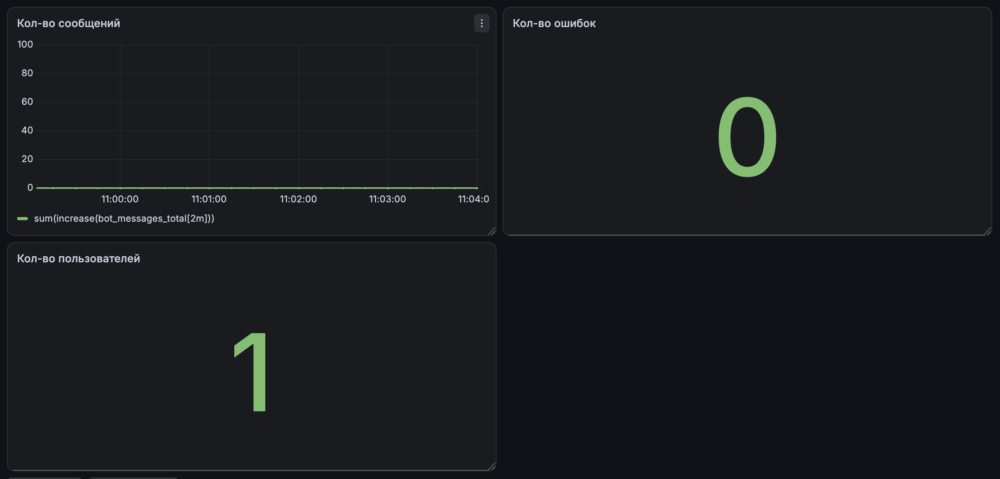

# Системы мониторинга Prometeus, Grafana и другие.

# Задание:

Провести настройку Prometeus, Grafana. Администрирование, мониторинг работы сервера
Практическое применение для анализа производительности, ресусов.
Настройка автоматических уведомлений (почта, системы мгновенных сообщений и т.п.)

## Ну что буду оформлять данную работу в виде статьи с моим опытом и ошибками

Первое что сделал я - стал разбираться как устроена Grafana и Prometheus,
зачем оши нужны и с чем их едят?

Наткнулся на видео ролик по становке и настройке графаны для мониторинга системы Ubuntu.
[Ссылка на видеоролик](https://www.youtube.com/watch?v=X_g-eJqiiLo)
Там я разобрался как в Docker поднять систему и настроить кластер для того чтобы следить
за системой

Результаты:


Что у меня получилось?

1) Запусить контейнер в docker с grafana + prometheus + node exporter
2) Посмотреть логи и нагрузку системы Ubuntu

- Grafana - платформа для визуализации, мониторинга и анализа данных
- Prometheus - система мониторинга и сбора метрик
- Node exporter - служебная программа, которая собирает аппаратные и систменые метрики операционной системы

Вот такая схема у меня получилась


## Идем дальше, а чем дальше тем интереснее

Я взялся за задачу построить такое взаимодейстие:

У меня есть несколько рабочих проектов расположенных на сервере и я хочу получать статистику нагрузки на каждый их проектов.

Пойдем по шагам и будем делать сначала на локальной машине:

1) Шаг №1 Поднять grafana + prometheus
2) Шаг №2 Сделать exporter логов из проектов
3) Шаг №3 Собрать полноценую систему

№1

docker-compose.yml

```yaml
version: '3.8'

services:
  prometheus:
    image: prom/prometheus:latest
    container_name: prometheus
    volumes:
      - ./prometheus.yml:/etc/prometheus/prometheus.yml
    ports:
      - "9090:9090"
    extra_hosts:
      - "host.docker.internal:host-gateway"

  grafana:
    image: grafana/grafana:latest
    container_name: grafana
    ports:
      - "3000:3000"
    environment:
      - GF_SECURITY_ADMIN_PASSWORD=admin
    volumes:
      - grafana-data:/var/lib/grafana

volumes:
  grafana-data:
```

prometheus.yml

```yaml
global:
  scrape_interval: 15s

scrape_configs:
  - job_name: 'test_bot'
    static_configs:
      - targets: ['host.docker.internal:8000']
```

У нас появиться 2 котейнера и так же настройки prometheus

Немного теории.

1. Pull-модель. Приложение не отправляет метрики, а выставляет их текстом по HTTP на /metrics. Prometheus по расписанию (scrape) забирает их.
2. Временной ряд = имя метрики + набор меток + значения во времени. Пример: http_requests_total{method="POST", status="500"}.

   Существуют четыре типа метрик:

- Counter - счетчик событий
- Gange - кол-во запросов
- Histogram - время ответ
- Summary

3) Кардинальность — количество уникальных комбинаций меток.

# Для того чтобы общаться с ptometheus используется PromQL - язык запросов

Пример таких обращений
сообщений в секунду — `rate(bot_messages_total[5m])`, за сутки — `increase(bot_messages_total[24h])`

## №2 Метрики в Telegram-боте

Prometheus сам ничего не знает о моём боте. Чтобы он увидел цифры, бот должен
их считать и показывать на странице `/metrics`. Для этого в Python есть библиотека
`prometheus_client`.

Я хотел видеть три вещи: **сколько обращений**, **сколько ошибок** и **сколько пользователей**.
Для каждой выбрал свой тип метрики:

| Что считаем                         | Метрика          | <br />Тип | Почему этот тип                                       |
| --------------------------------------------- | ----------------------- | ------------ | ------------------------------------------------------------------ |
| Обращения                            | `bot_messages_total`  | Counter      | число только растёт                               |
| Ошибки                                  | `bot_errors_total`    | Counter      | то же самое                                               |
| Уникальные пользователи | `bot_unique_users`    | Gauge        | значение можно просто выставить        |
| Время ответа                       | `bot_handler_seconds` | Histogram    | нужно распределение, а не одно число |

Сначала метрики объявляются (создаётся объект и он регистрируется в `prometheus_client`):

```python
MESSAGES = Counter("bot_messages_total", "Всего обращений к боту", ["type"])
ERRORS = Counter("bot_errors_total", "Ошибки в обработчиках", ["error_type"])
UNIQUE_USERS = Gauge("bot_unique_users", "Уникальных пользователей с момента запуска")
LATENCY = Histogram("bot_handler_seconds", "Время обработки сообщения")
```

Объявление только говорит: «такая метрика будет». Значения появляются, когда я вызываю
`.inc()`, `.set()` или `.observe()`.

### Где считать

Чтобы не писать подсчёт в каждом обработчике, я использовал **middleware** из aiogram.
Он выполняется на каждое сообщение до обработчика:

```python
class MetricsMiddleware(BaseMiddleware):
    async def __call__(self, handler, event: Message, data):
        text = event.text or ""
        kind = text.split()[0] if text.startswith("/") else "text" if text else "other"
        MESSAGES.labels(type=kind).inc()

        if event.from_user and event.from_user.id not in seen_users:
            seen_users.add(event.from_user.id)
            UNIQUE_USERS.set(len(seen_users))

        start = time.perf_counter()
        try:
            return await handler(event, data)
        finally:
            LATENCY.observe(time.perf_counter() - start)
```

Ошибки ловит отдельный обработчик:

```python
@dp.errors()
async def on_error(event: ErrorEvent):
    ERRORS.labels(error_type=type(event.exception).__name__).inc()
```

И один раз при старте поднимается HTTP-сервер, который отдаёт метрики:

```python
start_http_server(8000)
```

Важные детали, на которые я наткнулся:

- **Кардинальность.** В метку `type` я кладу только команду (`/start`) или слова `text` / `other`,
  а не сам текст сообщения. Иначе каждое уникальное сообщение создаст новый временной ряд.
- **Метрики с метками появляются не сразу.** Пока не было ни одного `.labels(...).inc()`,
  в `/metrics` нет ни одной строки такой метрики. Поэтому `bot_errors_total` не видно, пока не случится ошибка.
  Для проверки я добавил команду `/fail`, которая намеренно вызывает исключение.
- **Уникальные пользователи хранятся в памяти.** После перезапуска бота счётчик обнулится.
  Для настоящей статистики пользователей нужно брать из базы данных.

## №3 Бот в Docker

Чтобы вся система поднималась одной командой, я добавил бота в `docker-compose.yml`.

`Dockerfile`:

```dockerfile
FROM python:3.12-slim
WORKDIR /app
COPY requirements.txt .
RUN pip install --no-cache-dir -r requirements.txt
COPY bot_exemple.py .
CMD ["python", "-u", "bot_exemple.py"]
```

Новый сервис в `docker-compose.yml`:

```yaml
  bot:
    build: .
    container_name: tg_bot
    env_file: .env
    restart: unless-stopped
```

Токен бота лежит в `.env` и в образ не попадает (он указан в `.dockerignore`).

Так как контейнеры находятся в одной сети docker-compose, они обращаются друг к другу по имени сервиса.
Поэтому в `prometheus.yml` адрес `host.docker.internal:8000` я заменил на `bot:8000`:

```yaml
  - job_name: 'test_bot'
    static_configs:
      - targets: ['bot:8000']
```

Запуск:

```bash
docker compose up -d --build
docker compose logs -f bot
```

### Как проверить, что Prometheus видит бота

1. Открыть `http://localhost:9090/targets`: у `test_bot` должен быть статус **UP**.
2. Написать боту `/start` и `/fail`, подождать 15-30 секунд.
3. На `http://localhost:9090/graph` выполнить запрос `bot_messages_total`.
   Должны появиться ряды с `type="/start"` и т.д.

## №4 Дашборд в Grafana

1. Зайти на `http://localhost:3000` (логин и пароль `admin`).
2. **Connections → Data sources → Add data source → Prometheus**.
   В поле URL указать `http://prometheus:9090`. Не `localhost`: Grafana работает в контейнере
   и обращается к Prometheus по имени сервиса. Нажать **Save & test**.
3. **Dashboards → New → Add visualization**, выбрать источник Prometheus.
4. Переключить редактор запроса с **Builder** на **Code** и вставить запрос.



Запросы для панелей:

| Панель                         | Тип      | PromQL                                                                           |
| ------------------------------------ | ----------- | -------------------------------------------------------------------------------- |
| Обращений за сутки   | Stat        | `sum(increase(bot_messages_total[24h]))`                                       |
| Обращений в секунду | Time series | `sum(rate(bot_messages_total[5m]))`                                            |
| Ошибок за сутки         | Stat        | `sum(increase(bot_errors_total[24h])) or vector(0)`                            |
| Процент ошибок          | Gauge       | `sum(rate(bot_errors_total[5m])) / sum(rate(bot_messages_total[5m])) * 100`    |
| Пользователей           | Stat        | `bot_unique_users`                                                             |
| p95 времени ответа      | Time series | `histogram_quantile(0.95, sum by (le) (rate(bot_handler_seconds_bucket[5m])))` |

Пояснения к запросам:

- `rate(...[5m])` показывает скорость роста счётчика в секунду за последние 5 минут.
- `increase(...[24h])` показывает, на сколько счётчик вырос за 24 часа.
- `sum(...)` складывает ряды с разными метками в одно число.
- `or vector(0)` показывает 0 вместо «No data», пока ошибок ещё не было.



## Ошибки, на которые я потратил время

**1. «No data», хотя запрос правильный.**
Я вставил PromQL в режим **Builder**, и Grafana приняла весь запрос за имя метрики.
В Builder выбирается только метрика из списка, а готовые выражения нужно вводить в режиме **Code**.

**2. Метрика `bot_messages_total` не находится в Prometheus.**
Цель `test_bot` была в статусе UP, а в логах бота повторялось:

```text
TelegramConflictError: terminated by other getUpdates request;
make sure that only one bot instance is running
```

Оказалось, что параллельно был запущен локальный бот с тем же токеном. Telegram отдаёт сообщения
только одному из них, и все они доставались локальному процессу, а не контейнеру. Счётчик в контейнере
не увеличивался, поэтому ряда `bot_messages_total` не было. После остановки локального бота всё заработало.

**3. Нет метрики `bot_errors_total`.**
Это не ошибка: метрика с метками создаётся только после первого `.inc()`. Достаточно отправить боту `/fail`.

## Итог

Схема, которая у меня получилась:

```text
Telegram -> бот (aiogram) -> /metrics :8000 <- Prometheus :9090 <- Grafana :3000
```

Бот сам считает обращения, ошибки и пользователей, Prometheus раз в 15 секунд забирает значения,
а Grafana рисует графики по запросам на PromQL. Всё поднимается одной командой `docker compose up -d --build`.

## Что дальше

- Настроить алерт: ошибок больше 5% в течение 5 минут, уведомление в Telegram.
- Хранить пользователей в базе данных, а не в памяти.
- Подключить Loki, чтобы смотреть не только метрики, но и сами логи бота.
- Добавить дашборд в provisioning, чтобы он появлялся автоматически при запуске.
